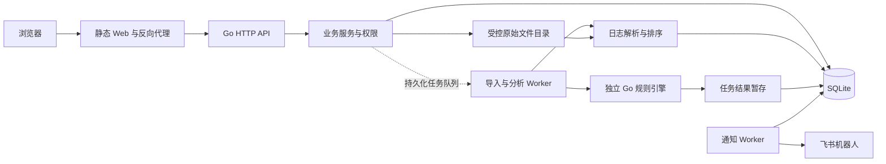

# NetSentinel 前后端与数据实现设计

版本 v0.1，状态为待评审设计。目录、表和接口均为后续实现契约。本文件覆盖解析与任务提交构件、数据持久化、API、Web 和部署，规则算法以独立规则引擎详细设计为准。

## 1. 总体架构与目录

采用模块化单体服务，进程内后台 Worker 执行导入、分析和通知，独立引擎以 Go module 形式被调用。前端构建为静态资源，容器反向代理将 `/api/` 转发给 Go 服务，浏览器使用同源会话。



计划目录如下，当前提交中的规划文档会随实施更新为正式规格。

```text
NetSentinel/
  engine/
    go.mod
    event/
    rule/
    predicate/
    detector/
    runtime/
    finding/
    testdata/
  backend/
    go.mod
    cmd/server/
    internal/api/
    internal/auth/
    internal/parser/
    internal/dataset/
    internal/analysis/
    internal/alert/
    internal/audit/
    internal/notification/
    internal/repository/
    migrations/
    testdata/
  frontend/
    src/app/
    src/features/auth/
    src/features/datasets/
    src/features/rules/
    src/features/tasks/
    src/features/alerts/
    src/features/audit/
    src/features/settings/
    src/shared/api/
    src/shared/components/
    src/shared/styles/
  models/
  deploy/
  Documentation/
  .github/
```

`backend/go.mod` 通过本地 module replace 引用 `../engine`，构建上下文为仓库根目录。引擎自身能独立编译测试，backend 集成测试使用真实 engine 入口。后端采用标准库 `net/http`、`encoding/json`、`database/sql`、`context` 和 `log/slog`，避免增加业务无关框架。

SQLite 的 Go 驱动拟评估 `modernc.org/sqlite`，密码散列拟使用 `golang.org/x/crypto/bcrypt`，前端采用 React、TypeScript 与 Vite 构建。它们为实现既定能力所需的候选依赖，编码前通过 ADR 确认并锁定版本和许可证。表单使用 React 状态，HTTP 使用 fetch，样式使用 CSS，首版按 URL 与 History API 管理少量页面路由。

## 2. 日志导入与解析构件

### 2.1 输入格式与模板

| 格式 | 具体输入 | 解析行为 |
| --- | --- | --- |
| `nginx_combined` | remote_addr、remote_user、time_local、request、status、body_bytes_sent、referer、user_agent | 使用带引号与转义状态的扫描器读取字段，按 Nginx 格式处理转义 |
| `nginx_json_v1` | 每行 JSON，键为 time_iso8601、remote_addr、request_method、request_uri、status、body_bytes_sent | 按固定模板解码并拒绝重复键，status/bytes 允许整数或纯数字字符串并校验范围，拒绝映射漂移 |
| `ssh_rfc3164` | 如 `Nov 13 12:00:00 host sshd[123]: Failed password for root from 192.0.2.10 port 2222 ssh2` | year/timezone 必填，识别进程、消息及合法 IP |
| `ssh_rfc3339` | 如 `2026-11-13T12:00:00+08:00 host sshd[123]: Accepted publickey for root from 192.0.2.10 port 2222 ssh2` | 使用显式年份及时区，其他字段遵循相同消息模板 |

Nginx combined 的 request 可以为空或 `-`，此时该行无法生成有效 http.access，记录 `REQUEST_INVALID`。只有明确声明模板的自定义 JSON 纳入首版，导入页展示模板及例子。Nginx 的 access_log 可配置格式，因此预览必须确认所选格式与真实输入匹配。[Nginx 日志模块官方文档](https://nginx.org/en/docs/http/ngx_http_log_module.html)

SSH 支持 Failed password、Failed publickey、Accepted password、Accepted publickey 以及经夹具确认的 keyboard-interactive 变体。`Failed ... for invalid user <name> from <ip>` 产生一条失败事件并设 invalid_user=true。独立 `Invalid user ...`、断开及 session 行保存为忽略行统计，防止同一次认证重复计数。未知 sshd 消息归入 ignored，格式损坏的目标认证消息归入 parse_errors。

每个数据集首版对应一个文件、一种格式、一个 source_host。SSH 原文主机与导入主机不同可以使用显式映射参数，映射进入解析配置及数据集摘要，界面显示映射，无映射的冲突行记录 `HOST_MISMATCH`。

### 2.2 导入实现步骤

1. HTTP 层检查 admin、CSRF、multipart 参数与文件大小，候选上限为 100 MiB，单行上限为 64 KiB，仅接收 UTF-8 明文。
2. 使用服务端随机文件名写临时目录，流式计算 SHA-256，不使用客户端文件名拼接真实路径。
3. 规范化解析配置，计算 dataset_digest，若同摘要存在 ready/importing 数据集则复用并删除新临时副本。
4. 短事务创建或重试 failed 数据集，登记 import_attempt、源文件元数据及 importing 状态，将临时文件移入受控目录。
5. Worker 按行读取，移除行结束符，完成字符、时间、来源和字段检查，按 500 行批量写入事件、忽略统计和错误行。
6. 全部行处理完成后，按事件时间和行号分配 event_index，检查总数恒等式与有效事件摘要。
7. 事务将数据集切换 ready 并写入 audit，若有效事件为零或系统失败，切换 failed。

文件移动与数据库事务分别处理。受控目录与临时目录置于同一数据卷，先用服务端确定的存储标识完成重命名，再提交 source_files 引用；数据库提交失败时清理新文件。进程启动扫描无数据库引用的临时/孤立文件，按保留期清理；存在引用但文件缺失或摘要错误的数据集标记 failed 并禁止分析。导入与重试通过 dataset_digest 唯一约束及 row_version 条件更新互斥，复用成功数据集时保留其原始文件。

`total_lines = valid_event_lines + ignored_lines + error_lines`，空行计入 ignored_lines。解析错误不阻止其他合法行进入 ready，但界面必须展示错误占比并要求用户查看。只要有效事件大于零可完成，严格错误占比门槛待调研确认。上传截断、磁盘故障与时间参数缺失属于整体失败。

失败导入的已写事件与错误行对分析不可见。重试前清理该数据集的旧导入产物，保留 import_attempts 历史。成功数据集固定，后续相同请求复用。进程重启将 importing 标记 failed，保留原因并允许显式重试。

### 2.3 原始证据访问

source_files 保存内部路径、字节摘要、原名和大小，raw_lines 保存 line_no、byte_offset、byte_length、raw_hash 与安全分类。查看原文时按偏移读取文件并核对摘要，返回 JSON 字符串，由 React 文本节点渲染。文件路径与系统细节不进入公开 API。

ready 数据集、源文件及已被告警引用的事件首版保留，未提供删除接口。后续保存期限和归档策略由需求变更确认。暂存文件和失败运行结果按明确周期清理，清理动作记录目标数量及审计。

## 3. 分析与原子提交构件

### 3.1 创建与领取

创建分析任务验证数据集 ready、规则已发布、来源兼容、版本存在及当前引擎可执行该语义版本。任务快照包含数据集摘要、解析器版本、规则版本与 spec_hash、engine_semantics_version、引擎构建号、配额及排序版本。

客户端提交 Idempotency-Key，服务保存 `(actor_id, operation, key, request_hash, response)`。相同键和同一请求返回原任务，相同键不同内容返回 409。任务与幂等记录同事务写入，避免重复点击创建额外执行。

单机首版仅一个分析 Worker，数据库 queued 状态为可靠队列，进程内通知仅用于唤醒。Worker 用条件更新领取最早 queued 任务为 running，记录启动时间。导入和通知使用独立的有界执行循环，数据库写入统一串行调度，查询连接独立。

### 3.2 执行与 staging

Repository 以 `(dataset_id,event_index)` 分页读取，释放读事务后交给引擎，避免长期持有 WAL 快照。输入不可变保证分页一致。sink 以任务 ID 批量写入 task_findings，携带 fingerprint、result_digest、结构化解释和全部证据引用。

任务进度由扫描条数/固定总事件数和当前 phase 组成。扫描达到 100% 后进入 committing，页面继续显示提交阶段，直到事务成功。进度更新按 500 条或 500 ms 合并，错误详情保存 code、phase 与安全消息。

### 3.3 结果发布事务

Run 成功后先通过短事务将 running 推进 committing 并持久化 phase，使查询页面能够显示提交阶段，随后启动单个结果发布事务。

1. 条件确认任务仍处于 committing，当前 Worker 持有该任务。
2. 遍历 task_findings，按 fingerprint 查找或插入 alerts。
3. 新告警保存不可变解释与证据，status=open，assignee=null，row_version=1。
4. 已存在告警核对 result_digest，一致则复用，差异则回滚并报 `RESULT_INCONSISTENT`。
5. 写入 task_alerts 关联，唯一键为 `(task_id,alert_id)`，统计新增与复用数。
6. 对新 high/critical 告警，在存在启用通知配置时写唯一 Outbox，保存配置版本及固定消息正文。
7. 保存任务完成指标和审计，切换 succeeded，提交事务。

规则当前启用状态与草稿内容不参与既有任务执行。已有告警的 status、assignee、row_version、处置历史均不更新。正式告警查询不读取 staging。提交失败时整体回滚，再单独事务把任务标记 failed，保留 staging 错误线索并安排清理。

单次发布受输出预算约束，提交过程中其他写操作排队，后续性能实测若显示事务过大，须通过设计评审优化发布方式并保持整体可见性。

### 3.4 重启与重跑

服务启动时将遗留 running/committing 任务标记 failed，错误为 `PROCESS_INTERRUPTED`，清理其未发布 staging，queued 保留并可领取。事务已成功的任务自然保持 succeeded，数据库恢复保证告警与任务终态一致。

重跑接口复制原任务完整快照并生成新 task_id。若当前部署缺少原 engine_semantics_version，则返回 409 `ENGINE_VERSION_UNAVAILABLE`，要求使用对应发布镜像复现。用户若选择当前规则或当前语义，则通过新建任务操作形成新的分析快照。

## 4. 数据模型与约束

### 4.1 通用约定

业务 ID 使用服务端生成的随机字符串，UTC 时间以 INTEGER 微秒保存，布尔值为带 CHECK 的 0/1，枚举使用 CHECK，关系使用外键。规则快照和解释使用 JSON TEXT，关键检索字段独立列。可变对象持有 row_version 做乐观并发控制。

SQLite 使用 WAL、本地数据卷和受控单写连接，所有连接初始化 foreign_keys=ON、busy_timeout，候选 busy_timeout=5,000 ms。WAL 允许读写并行，但同时只有一个 writer，因此写事务仍需串行组织，长读事务和 WAL 体积需监测。[SQLite WAL 官方说明](https://www.sqlite.org/wal.html) [SQLite PRAGMA 官方说明](https://www.sqlite.org/pragma.html#pragma_foreign_keys)

### 4.2 核心表

| 表 | 主要字段 | 关键约束与用途 |
| --- | --- | --- |
| users | id、username、password_hash、role、enabled、row_version、created_at | username 小写 ASCII 唯一，role CHECK，密码哈希不返回 API |
| sessions | token_hash、user_id、expires_at、created_at | token_hash 主键，user_id 外键，注销/停用级联撤销会话 |
| idempotency_records | actor_id、operation、key、request_hash、resource_id、response_json、expires_at | `(actor_id,operation,key)` 唯一，保存已提交响应 |
| datasets | id、dataset_digest、source、source_host、parser_version、config_json、status、各类行数、event_digest、row_version、created_by、created_at | dataset_digest 唯一，ready 后不可变 |
| import_attempts | id、dataset_id、started_at、finished_at、status、error_code | 保留每次失败与重试记录 |
| source_files | id、dataset_id、original_name、storage_path、file_hash、size_bytes | dataset_id 唯一外键，一数据集一文件 |
| raw_lines | file_id、line_no、byte_offset、byte_length、raw_hash、classification | `(file_id,line_no)` 主键，原始证据定位 |
| events | id、dataset_id、event_index、event_time_us、source、source_host、kind、src_ip、user_name、ssh_invalid_user、ssh_auth_method、http_method、http_path、http_status、http_bytes_sent、file_id、line_no | id 主键，`(dataset_id,event_index)` 唯一且 ready 前完整，`(file_id,line_no)` 关联 raw_lines |
| parse_errors | id、dataset_id、file_id、line_no、code、message | 对应原始行，错误文本脱敏，按数据集分页 |
| rules | id、name、enabled、latest_version、draft_revision、draft_json、row_version | id 稳定，draft_revision 条件更新，latest_version 指向发布历史 |
| rule_versions | rule_id、version、spec_json、spec_hash、engine_semantics_version、published_by、published_at | `(rule_id,version)` 主键，不可更新和删除 |
| analysis_tasks | id、dataset_id、created_by、created_at、status、phase、snapshot_json、engine_build、engine_semantics_version、processed_events、total_events、new_alerts、reused_alerts、stats_json、error_code、started_at、finished_at | 数据集与创建人外键，终态约束，状态条件更新 |
| task_rules | task_id、rule_id、rule_version、spec_hash | `(task_id,rule_id)` 主键，一个任务内同规则仅选一个版本，外键指向 rule_versions |
| task_findings | task_id、fingerprint、result_digest、payload_json | `(task_id,fingerprint)` 主键，任务未发布结果 |
| sandbox_tasks | id、actor_id、dataset_id、spec_json、status、result_json、stats_json、expires_at | 与正式告警流程隔离，候选保留 24 小时 |
| alerts | id、fingerprint、result_digest、dataset_id、rule_id、rule_version、engine_semantics_version、severity、group_json、trigger_event_id、trigger_time_us、window_start_us、window_end_us、reason_json、status、assignee_id、row_version、created_at | fingerprint 唯一，引用规则版本、数据集、事件和负责人 |
| alert_evidence | alert_id、ordinal、event_id、stage_id | `(alert_id,ordinal)` 主键，`(alert_id,event_id)` 唯一，event_id 外键 |
| task_alerts | task_id、alert_id、is_new | `(task_id,alert_id)` 主键，记录每次执行的关联结果 |
| alert_actions | id、alert_id、actor_id、action、from_status、to_status、from_assignee、to_assignee、reason、created_at | 不可变处置历史，与告警更新同事务 |
| audit_logs | id、actor_id、action、object_type、object_id、request_id、change_json、result、created_at | 仅追加，敏感值脱敏，成功变更与业务同事务 |
| notification_configs | revision、enabled、encrypted_config、created_by、created_at | revision 主键，新配置形成新行，凭据加密保存 |
| notification_outbox | id、alert_id、channel、config_revision、payload_json、status、attempt_count、retry_cycle、next_attempt_at、lease_until、last_error、sent_at、row_version | `(alert_id,channel)` 唯一，引用固定配置版本 |
| notification_attempts | id、outbox_id、attempt_no、retry_cycle、started_at、finished_at、http_status、provider_code、result、error_summary | `(outbox_id,attempt_no)` 唯一，响应脱敏与限长 |

幂等键候选保存 7 天，过期后删除，仅影响重复 API 请求合并。告警去重依赖永久 fingerprint 唯一约束，独立于 API 幂等键。审计和处置历史不可通过业务接口编辑。

### 4.3 查询索引与迁移

| 索引 | 使用场景 |
| --- | --- |
| `events(dataset_id,event_index)` | 按稳定顺序扫描引擎输入 |
| `events(dataset_id,event_time_us,id)` | 时间筛选及稳定分页 |
| `events(dataset_id,src_ip,event_time_us)` | 按来源核查证据 |
| `alerts(trigger_time_us DESC,id DESC)` | 默认告警列表 |
| `alerts(status,severity,trigger_time_us DESC,id DESC)` | 处置工作台 |
| `alerts(rule_id,rule_version,trigger_time_us)` | 规则历史结果 |
| `analysis_tasks(status,created_at,id)` | Worker 领取与任务列表 |
| `audit_logs(object_type,object_id,created_at,id)` | 对象审计时间线 |
| `notification_outbox(status,next_attempt_at,id)` | 领取待投递任务 |

SQL 使用绑定参数，筛选字段和排序方向白名单化。告警 src_ip 筛选通过 alert_evidence 关联 events 的 EXISTS 子查询实现，覆盖 R-007 这类多来源告警，查询仅返回一次告警。列表首版采用 page/page_size 与稳定二级 ID 排序，page_size 默认 20、最大 100。正式结果快照固定，活动列表因新增可变动，页面提示刷新并按 ID 定位详情。

迁移使用编号 SQL、schema_migrations 和启动时版本检查，生产迁移单独步骤执行。新库与前一版本升级均进入集成测试。SQLite 数据库文件与源文件共同备份，运行中使用 SQLite 一致备份 API 或停止服务后整体备份，完成恢复后校验数据库、文件摘要及样例告警引用。[SQLite Backup API 官方说明](https://www.sqlite.org/backup.html)

## 5. 认证、授权与审计

用户名使用小写 ASCII 3—32 位，密码候选为至少 12 个字符且 UTF-8 编码不超过 72 字节。bcrypt 工作因子初始拟为 12，结合登录耗时实测确认，始终采用成熟库的生成和验证 API。72 字节限制来自 bcrypt 接口，前后端都应给出明确校验。[Go bcrypt 官方文档](https://pkg.go.dev/golang.org/x/crypto/bcrypt)

使用 crypto/rand 生成 32 字节会话 token，数据库仅保存 SHA-256 摘要。Cookie 设置 HttpOnly、SameSite=Lax、Path=/，HTTPS 环境设置 Secure，会话候选有效期 8 小时。登录按 IP 与用户名限速，错误文案统一，密码与 token 不进入日志。

每次请求由中间件读取有效会话及用户当前 enabled/role，再执行路由权限和对象权限。写接口校验 Origin 与 CSRF header，登录校验同源 Origin，me 接口返回当前会话对应 CSRF token。注销、密码或角色变更撤销会话。

CSRF token 由当前请求的原始会话 token 作为 HMAC-SHA256 key，对固定消息 `csrf-v1` 计算并编码，登录与 me 返回同一派生值，验证时常量时间比较。服务端从 HttpOnly Cookie 取得原始会话 token，数据库仅存会话摘要，多标签页无需轮换 CSRF 值。

审计覆盖登录结果、用户变更、导入、规则保存/发布/启停、分析创建/完成/失败、认领/处置、通知配置和手动重投。成功业务变更与 audit_logs 同事务，拒绝访问及登录失败单独记安全审计。change_json 仅保存字段变化与脱敏摘要，webhook、密码、Cookie、加密密钥均排除。

## 6. HTTP API 契约

### 6.1 通用协议

基础路径 `/api/v1`，除文件上传外使用 JSON。时间响应为带 Z 的 RFC3339 微秒字符串，ID 为字符串，窗口和阈值为整数。可选字段缺失以 null 表示，前端转换为界面展示值。成功响应为 `{ "data": ..., "request_id": "..." }`，列表额外在 data 内包含 items、page、page_size、total。

错误结构如下，path 使用 JSON Pointer 或表单字段名。

```json
{
  "error": {
    "code": "RULE_VALUE_TYPE",
    "message": "http.status 的比较值必须为整数",
    "details": [{"path": "/where/all/1/value", "message": "需要 integer"}]
  },
  "request_id": "req-example"
}
```

状态码约定为 400 请求语法错误、401 未登录、403 无权限、404 对象不存在、409 状态/版本/幂等冲突、413 文件或请求超限、422 规则/业务参数校验失败、429 限速、500 内部故障、503 服务未就绪。异步创建返回 202，普通创建返回 201，查询和更新返回 200，注销返回 204。

### 6.2 接口清单

权限 A 表示 admin，N 表示 analyst，U 表示 auditor，`全部` 包括三者。所有修改接口具有审计和对应对象的版本或幂等控制。

| 方法与路径 | 权限 | 请求与响应关键内容 |
| --- | --- | --- |
| POST `/auth/login` | 未登录 | username/password → user、role、csrf_token 与会话 Cookie |
| POST `/auth/logout` | 全部 | 撤销当前会话，204 |
| GET `/auth/me` | 全部 | id、username、role、permissions、csrf_token |
| GET `/users` | A | 分页用户，排除散列 |
| POST `/users` | A | username/password/role → 用户 |
| PATCH `/users/{id}` | A | enabled/role/password/row_version，角色或凭据变化撤销会话 |
| POST `/datasets/preview` | A | multipart file + format/source_host/timezone/year → 前 100 行解析预览、错误与格式提示 |
| POST `/datasets` | A | multipart 原文件及相同参数，Idempotency-Key → 数据集与导入状态 |
| POST `/datasets/{id}/retry-import` | A | failed 数据集、row_version、Idempotency-Key → 新导入尝试 |
| GET `/datasets` | 全部 | source/status/host/page/page_size → 数据集列表 |
| GET `/datasets/{id}` | 全部 | 摘要、行数、版本、进度、时间范围及错误 |
| GET `/datasets/{id}/events` | 全部 | time_from/time_to/src_ip/user/kind/page → 标准化事件 |
| GET `/datasets/{id}/errors` | 全部 | code/page → 解析失败行及原因 |
| GET `/datasets/{id}/lines/{line_no}` | 全部 | 安全原文、摘要及解析分类 |
| GET `/rules` | 全部 | source/type/enabled → 已发布规则及最新版本，A 可含草稿 |
| POST `/rules` | A | RuleSpec → rule_id、draft_revision、校验结果 |
| GET `/rules/{id}` | 全部 | 已发布摘要，A 另返回草稿和修订 |
| PUT `/rules/{id}/draft` | A | spec/draft_revision → 新修订，冲突 409 |
| POST `/rules/validate` | A/N | spec → valid、errors、规范化摘要 |
| POST `/rules/sandbox` | A/N | dataset_id/spec/Idempotency-Key → sandbox_task_id |
| GET `/rules/sandbox/{id}` | A/N | 本人或 A 可查，返回状态、Finding、指标及到期时间 |
| POST `/rules/{id}/publish` | A | draft_revision/row_version → 新的不可变版本 |
| PATCH `/rules/{id}/enabled` | A | enabled/row_version → 当前状态及新 row_version |
| GET `/rules/{id}/versions` | 全部 | 历史版本列表 |
| GET `/rules/{id}/versions/{version}` | 全部 | 完整 spec、hash、发布者及语义版本 |
| POST `/tasks` | A/N | dataset_id/rules 与 Idempotency-Key → task_id、status、snapshot |
| GET `/tasks` | 全部 | status/dataset_id/page → 任务列表 |
| GET `/tasks/{id}` | 全部 | phase、进度、快照、指标、失败原因及新增/复用数 |
| POST `/tasks/{id}/rerun` | A/N | Idempotency-Key → 相同快照的新任务 |
| GET `/tasks/{id}/alerts` | 全部 | task_alerts 对应告警，附 is_new |
| GET `/alerts` | 全部 | severity/status/rule_id/src_ip/time_from/time_to/page → 列表 |
| GET `/alerts/{id}` | 全部 | 规则版本、分组、窗口、指标、reason、状态、assignee、row_version |
| GET `/alerts/{id}/evidence` | 全部 | page → 按 ordinal 的事件、stage、原始引用 |
| GET `/alerts/{id}/actions` | 全部 | 处置历史时间线 |
| POST `/alerts/{id}/claim` | A/N | row_version、Idempotency-Key → acknowledged、当前负责人 |
| POST `/alerts/{id}/assign` | A | assignee_id/reason/row_version、Idempotency-Key → 转派 |
| POST `/alerts/{id}/actions` | A/N | action/reason/row_version、Idempotency-Key → 更新状态或备注 |
| GET `/audit-logs` | 全部 | actor_id/action/object_type/object_id/time/page → 脱敏审计 |
| GET `/notifications/config` | A | 启用状态、当前 revision、脱敏配置 |
| PUT `/notifications/config` | A | enabled/webhook/secret/revision → 新配置版本，旧 revision 冲突 409 |
| POST `/notifications/test` | A | revision/Idempotency-Key → 测试投递状态，不创建业务告警 |
| GET `/notifications/deliveries` | 全部 | status/alert_id/page → 投递状态 |
| GET `/notifications/deliveries/{id}/attempts` | 全部 | 脱敏投递尝试历史 |
| POST `/notifications/deliveries/{id}/retry` | A | row_version、Idempotency-Key → 重启失败记录的重试周期 |
| GET `/metrics/summary` | 全部 | 时间范围、数据集量、告警分布、任务耗时与吞吐 |
| GET `/health/live` | 无 | 进程存活，无敏感信息 |
| GET `/health/ready` | 无 | 数据库、迁移、可写目录就绪状态，无敏感信息 |

发布接口 `publish` 返回的 version 是规则检测版本，enabled 接口返回 row_version 用于并发控制。两者在响应中使用各自明确字段名。

### 6.3 核心交互样例

创建任务请求如下，单个数据集只选择兼容来源的规则。

```http
POST /api/v1/tasks
Content-Type: application/json
Idempotency-Key: analysis-example-001
X-CSRF-Token: <session-token>

{
  "dataset_id": "ds-ssh-example",
  "rules": [
    {"rule_id": "R-001", "version": 1},
    {"rule_id": "R-003", "version": 1}
  ]
}
```

```json
{
  "data": {
    "task_id": "task-example",
    "status": "queued",
    "snapshot": {
      "dataset_id": "ds-ssh-example",
      "dataset_digest": "sha256-example",
      "rules": [
        {"rule_id": "R-001", "version": 1, "spec_hash": "hash-a"},
        {"rule_id": "R-003", "version": 1, "spec_hash": "hash-b"}
      ],
      "engine_semantics_version": "1"
    }
  },
  "request_id": "req-example"
}
```

告警动作请求中的 action 为 comment、close 或 false_positive，claim 与 assign 使用专门端点。close/false_positive 的 reason 不能为空，候选最大 2,000 字符，comment 也必须非空。条件 SQL 形态为 `UPDATE alerts SET ... WHERE id=? AND row_version=? AND status=?`，受影响行数为零则返回 409 或权限相关错误。

## 7. React Web 实现

### 7.1 组织与状态

使用 TypeScript 严格模式，统一定义 RuleSpec、Event、Finding、Task、Alert、APIError 等传输类型。`shared/api` 封装 base URL、Cookie、CSRF、JSON 解码、AbortController 和结构化错误。权限及当前用户存放 AuthContext，页面查询状态归属对应 feature，表单草稿使用 useReducer。

路由与筛选条件写入 URLSearchParams，浏览器前进后退恢复列表。详情按 ID 重新查询，避免跨页面重复维护同一告警状态。任务与导入按 1—3 秒有界轮询，终态停止，页面隐藏时降低频率，卸载时取消请求。写操作暂时禁用重复提交并携带幂等键，超时后使用同一键查询结果。

本地表单先做必填与基础类型校验，服务端返回的 JSON Pointer 映射字段错误。规则表单和 JSON 编辑共享一个 RuleSpec，切换视图前先解析校验，避免两份状态漂移。后端响应为最终权限与状态依据。

### 7.2 页面与组件清单

| 页面与路径 | 展示与动作 | 组件/实现重点 | 异常与空状态 |
| --- | --- | --- | --- |
| 登录 `/login` | 用户名、密码、登录 | LoginForm、AuthProvider，成功恢复原目标 URL | 统一凭据错误、限速提示、提交中禁用 |
| 工作台 `/` | 待处置量、严重性分布、最近任务、耗时与吞吐 | SummaryCards、SeverityChart、RecentTasks，所有图表提供文本汇总 | 首次使用给出导入入口，auditor 显示只读入口 |
| 数据集 `/datasets` | 状态、格式、主机、行数、错误数、时间、导入 | DatasetTable、筛选、分页 | 无数据、导入失败、权限受限 |
| 导入 `/datasets/import` | 文件、模板、时区、年份、主机、预览与确认 | UploadForm、ParserPreview、ErrorRows，完整文件正式上传后异步跟踪 | 文件超限、字段缺失、格式不符、网络中断 |
| 数据集详情 `/datasets/:id` | 元信息、事件列表、失败行、原始行 | Tabs、EventTable、RawLinePanel，表格分页和文本转义 | importing/failed/ready 三种状态明确 |
| 规则库 `/rules` | 类型、来源、启用、最新版本、编辑和历史 | RuleTable、RuleStatus、PermissionAction | 无规则引导 admin 创建，其余角色提示只读 |
| 规则编辑 `/rules/:id/edit` | 公共字段、谓词、分组、窗口、阈值或阶段 | RuleForm、PredicateEditor、JSONEditor、ValidationPanel、SandboxPanel | 路径级错误、草稿冲突、沙箱超限、未保存离开提醒 |
| 规则版本 `/rules/:id/versions/:v` | 固定配置、发布信息、两版本字段差异 | RuleSpecViewer、VersionDiff | 版本缺失、来源不兼容提示 |
| 新分析 `/tasks/new` | 数据集、兼容规则版本、参数确认 | DatasetSelector、RuleVersionSelector、SnapshotPreview | 无 ready 数据集、未选规则、语义版本不可用 |
| 任务列表/详情 `/tasks`、`/tasks/:id` | 状态、阶段、进度、快照、耗时、新增/复用、重跑 | TaskTable、TaskProgress、SnapshotPanel、TaskAlerts | 失败码、排队、重跑冲突和请求断线 |
| 告警列表 `/alerts` | 严重性、状态、规则、来源、时间、负责人 | AlertFilters、AlertTable、分页，URL 保存筛选 | 无命中、过滤无结果、加载失败 |
| 告警详情 `/alerts/:id` | 命中原因、规则版本、窗口、证据、认领和处置 | ReasonPanel、EvidenceTimeline、RawLinePanel、ActionForm、ActionHistory | 认领冲突、终态只读、理由校验、证据加载失败 |
| 审计 `/audit` | 操作者、动作、对象、时间及变更摘要 | AuditFilters、AuditTable、详情面板 | 脱敏值、空结果、查询错误 |
| 用户 `/settings/users` | 用户、角色、启停和凭据设置 | UserTable、UserForm | 最后 admin 保护、并发冲突 |
| 通知 `/settings/notifications` | 配置、测试、投递、尝试历史和手动重投 | NotificationForm、DeliveryTable、AttemptList | 保存版本冲突、不可用配置、超时/限流/dead |

规则表单根据 Count/Distinct/Sequence 只展示适用字段，字段选择按来源过滤。Sequence UI 直接显示“第一阶段至少 k 次，随后第二阶段一次，时间窗口 W”，并标注 finish 清空已累计事件。发布前展示实际规则摘要、沙箱结果和待发布修订号。

告警详情先显示 severity、status、rule/version、group 和实际指标，再展示窗口及证据时间线。Sequence 以 start/finish 标签区分失败与成功，表格保留 event_index、时间、用户、IP、原始行入口。窗口左边界与第一条证据分别标注。

### 7.3 交互与可访问性

界面使用中文，规则/API 标识保留原文。桌面以侧导航和内容区组织，小屏导航折叠，密集表格允许横向滚动，关键动作保持可访问。表单关联 label 与错误描述，键盘可完成筛选、发布和处置，弹窗管理焦点与 Esc，严重性使用文字和颜色共同表达。

每个请求具备 loading、empty、error、success 状态。409 显示当前对象已更新并提供重新加载操作，保留用户尚未提交的理由或草稿。403 页面显示当前权限和返回入口。会话失效跳转登录，敏感表单值不写 localStorage。

## 8. 飞书通知实现

admin 保存 webhook 和签名 secret 时创建新的 notification_configs revision。使用环境密钥通过标准库 AES-GCM 加密配置，数据库仅存密文，API 读取仅返回脱敏地址和 configured 标记，空值默认保留既有 secret，显式清空使用单独字段。出站目标限制为已确认的飞书官方 webhook HTTPS 域名及路径，HTTP 客户端禁用重定向。

通知由结果发布事务生成。每条新 high/critical 告警在配置启用时创建一条 `channel=feishu` Outbox，记录固定 config_revision 和消息正文。消息只包含规则、级别、主机、脱敏来源、时间、指标与平台内告警链接，避免携带原始敏感日志。

Worker 通过条件更新取得发送租约，先创建 attempt 记录再发出请求。候选 HTTP 超时 5 秒，校验 HTTP 状态及响应业务 code，单周期共 5 次尝试，失败后等待 5、15、45、120 秒，另加有界随机抖动。可重试超时、网络错误、429、5xx，确定性签名/配置错误直接 dead。上限后保留原因，admin 可手动开启新重试周期，attempt_no 持续递增。

签名使用飞书文档定义的 timestamp 与 secret 组成 HMAC key，对空消息计算 SHA-256 HMAC 并 Base64 编码。每次尝试重新生成 timestamp/sign，secret 及完整 webhook 均不进入记录。[飞书自定义机器人官方指南](https://open.feishu.cn/document/client-docs/bot-v3/add-custom-bot?lang=en-US)

发送成功后写 sent，若远端已接收但本地确认前服务中断，租约过期重试可能再次发送，因此投递采用至少一次语义。消息附稳定告警 ID 便于识别，数据库层保证同一告警只创建一个自动 Outbox。配置变更不改写历史投递的配置版本，停用通知后 Worker 暂停发送并保留队列，重新启用前由 admin 检查积压与历史配置。

测试投递使用独立测试记录或明确的 test 标记，避免混入业务告警及自动投递唯一约束。

## 9. 部署、可观测性与回滚

### 9.1 Compose 运行拓扑

| 服务/资源 | 作用 | 配置 |
| --- | --- | --- |
| web | 静态前端与同源代理 | 提供 SPA 路由回退，转发 `/api/`，上传上限与后端一致 |
| api | Go API 与后台 Worker | 内网端口，设置请求超时、优雅关闭与健康检查 |
| data volume | SQLite、原始文件与临时目录 | 本机文件系统，服务用户最小目录权限 |
| 环境配置 | 主密钥、初始 admin、PUBLIC_BASE_URL、配额 | `.env.example` 只含占位值，真实值从部署环境注入 |

部署流程计划为检出确定 Tag → 构建/拉取固定摘要镜像 → 备份旧数据 → 执行迁移 → Compose 启动 → ready 检查 → 导入固定样本与规则烟测 → 保存部署记录。初始管理员只在空数据库创建，密码来自一次性部署变量，启动日志不输出凭据。

### 9.2 运行与恢复

结构化日志包含 request_id、task_id、dataset_id、rule_id、phase、code、duration 和计数，统一脱敏。运行页面展示任务错误与通知积压。磁盘空间、WAL 体积、队列长度、失败数和处理耗时进入基础监测。

优雅关闭先停止接收新任务，通知 Worker 结束当前尝试，分析任务在候选 30 秒宽限内完成或取消。未完成执行按恢复策略标记 failed。回滚应用需要确认数据库迁移兼容性，无法兼容时停止服务并恢复配套一致备份，再运行旧镜像及固定数据烟测。

Compose、迁移和 Actions 的具体可执行文件在各增量中实现并验证，当前设计文档中的流程在实际执行后补充命令、环境与结果。

## 10. 待人工确认的 ADR

| ADR | 决策提案 | 理由与验证 |
| --- | --- | --- |
| ADR-001 | 模块化单体 + 独立 engine module | 便于四人交付与包级测试，评审依赖方向并验证独立构建 |
| ADR-002 | SQLite WAL、单写队列与短事务 | 适配单机部署，验证读写竞争及原子发布时间 |
| ADR-003 | 离线预排序与事件时间闭合窗口 | 可重跑且边界明确，通过固定夹具核对 |
| ADR-004 | 结构化 JSON 与两阶段 Sequence | 明确校验与消费语义，先覆盖课程核心规则 |
| ADR-005 | 告警指纹 + staging + Outbox | 统一解决重跑、失败部分结果及通知一致性 |
| ADR-006 | Cookie 会话、RBAC、CSRF、bcrypt | 支撑三角色授权与停用失效，安全场景逐项验证 |
| ADR-007 | React 原生状态、fetch 与 CSS，必要依赖锁定 | 控制实现复杂度，前后端契约优先，使用真实页面流程测试 |

每条正式 ADR 在团队评审后补充备选方案、实际决议、日期、责任人和影响。当前提案不替代人工架构签字。
