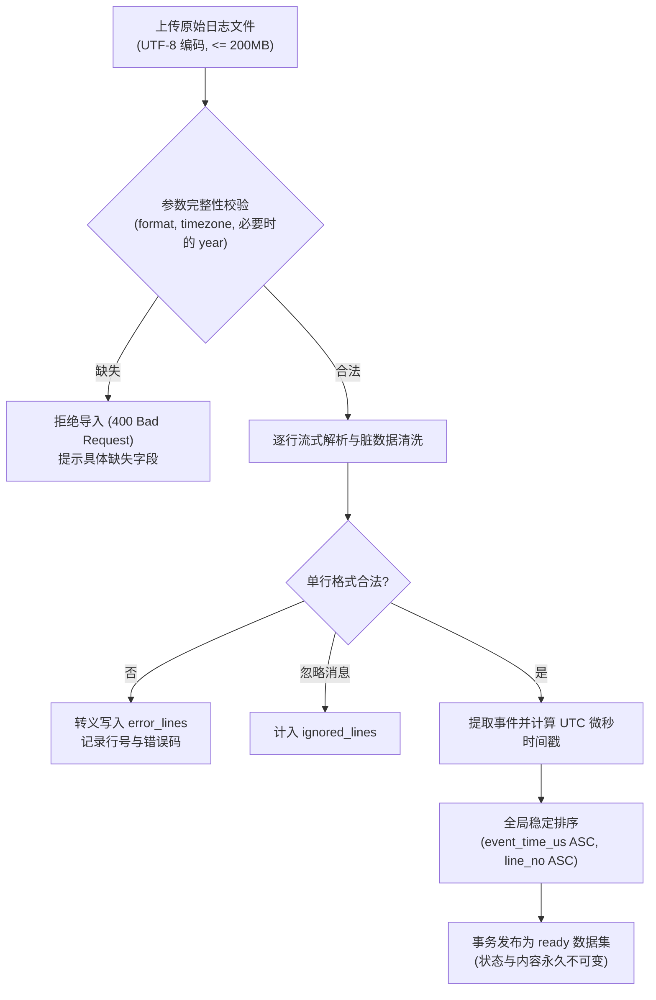

# 授权样本验证与输入规格记录

## 1. 目标与依据

本文档落实工作包 WP-02a（Issue #5）中“验证 Nginx/SSH 格式、时间字段和脱敏要求，记录格式差异与输入限制”的任务要求。
依据《项目章程》第 6 节、《需求调研计划》第 6 节及《独立规则引擎详细设计》，通过对实验室授权采集的真实日志样本进行格式核验、时间字段对齐、脱敏规则验证和异常边界挖掘，冻结系统输入层规范，为后续 WP-02b（需求规格 SRS）、WP-06（解析与导入）及独立规则引擎提供严谨的规格依据。

---

## 2. 样本采集源与授权范围

### 2.1 采集源概况

团队从实验室受控环境采集了 4 份代表性日志样本，覆盖日常运维与攻防演练中的典型真实场景：

| 样本编号 | 日志类型 | 来源环境 | 授权人与角色 | 场景特征与数据量 |
|---|---|---|---|---|
| **SAMPLE-NGINX-01** | Nginx `combined` 明文 | 实验室对外统一反向代理服务器 | 陈助教（SYS-ADMIN-01，系统管理员） | 包含正常学生访问、静态资源加载、搜索引擎爬虫及偶发 404/500（脱敏提取 500 行） |
| **SAMPLE-NGINX-02** | Nginx `combined` 明文 | 学院教学实验系统测试站点 | 严助教（SEC-ANALYST-01，安全排查员） | 包含 Web 漏洞扫描工具（Nikto/DirBuster）发起的路径枚举、敏感文件探测与 SQL 注入试探（脱敏提取 300 行） |
| **SAMPLE-SSH-01** | Linux SSH RFC 3164 | 实验教学机房 Linux 堡垒机 | 陈助教（SYS-ADMIN-01，系统管理员） | 包含公网针对 22 端口的高频密码字典爆破、不存在用户探测（脱敏提取 400 行） |
| **SAMPLE-SSH-02** | Linux SSH RFC 3339 | 实验室科研 GPU 算力服务器 | 严助教（SEC-ANALYST-01，安全排查员） | 包含连续爆破失败后紧随一次合法公钥/密码登录成功的失陷复合序列（脱敏提取 200 行） |

### 2.2 授权合规声明

- **合规依据**：依据《中华人民共和国网络安全法》第二十一条（网络日志留存不得少于六个月）与第四十二条（未经脱敏不得向他人提供个人信息）。
- **授权范围**：上述日志仅用于软件工程课程设计 NetSentinel 系统的需求调研、规则算法研发、离线测试与自动化验证，禁止流出实验代码库或用于任何商业用途。
- **脱敏承诺**：所有原始日志在入库与分析前，必须通过确定性脱敏管线处理，去除所有内部真实网络拓扑、师生真实账户名及会话凭据。

---

## 3. 严格脱敏规范与执行验证

团队建立了统一的脱敏清洗规范，所有测试样本均经核验满足以下条件：


### 3.1 IP 地址脱敏标准

1. **公网源 IP（外部访问者/攻击源）**：
   - 严禁出现真实公网 IP。
   - 统一映射至 IETF RFC 5737 规定的文档与测试专用 IPv4 地址块：
     - `192.0.2.0/24`（TEST-NET-1，用于高频爆破与扫描攻击源模拟）；
     - `198.51.100.0/24`（TEST-NET-2，用于偶发扫描与多源低频攻击模拟）；
     - `203.0.113.0/24`（TEST-NET-3，用于正常访客与搜索引擎爬虫模拟）。
2. **内网 IP（服务器与管理端口）**：
   - 统一映射至 RFC 1918 私网保留地址（如 `10.0.1.10`、`192.168.1.1`）。

### 3.2 身份与凭据脱敏标准

1. **用户名**：
   - 剔除真实学号、工号及邮箱前缀；
   - 统一替换为具有明确测试语义的占位符：如合法用户 `test_admin`、`test_student`、`deployer`；爆破尝试字典用户 `root`、`oracle`、`test`、`ubuntu`、`guest` 等。
2. **凭据与敏感字段**：
   - 严禁包含明文密码、API Key、Session ID、JWT 令牌；
   - Nginx 请求行中的参数若含有 `token=...` 或 `password=...`，统一替换为 `token=[FILTERED]`；
   - SSH 日志中绝不包含用户键盘输入的密码明文（Linux SSH 默认仅记录成功/失败状态，无密码明文泄露风险）。

---

## 4. 日志格式规格与字段对齐映射

### 4.1 格式一：Nginx combined 明文文本格式

#### 4.1.1 标准定义与配置语法

Nginx 官方标准的 `combined` 日志格式声明如下：

```nginx
log_format combined '$remote_addr - $remote_user [$time_local] '
                    '"$request" $status $body_bytes_sent '
                    '"$http_referer" "$http_user_agent"';
```

#### 4.1.2 字段映射到统一事件模型

| Nginx 源字段 | 示例值 | 目标事件模型字段 | 数据类型 | 约束与说明 |
|---|---|---|---|---|
| `$remote_addr` | `192.0.2.45` | `source_ip` | `string` | 合法 IPv4/IPv6 字符串，作为 Group Key 聚合主体 |
| `$remote_user` | `-` 或 `test_user` | `user` | `string` | HTTP Basic Auth 用户名；若为 `-` 则归一化为空字符串 |
| `$time_local` | `19/Nov/2026:14:22:01 +0800` | `event_time_us` | `int64` | 转换为 UTC 微秒时间戳；从自带的数值偏移解析时区 |
| `$request` (method) | `GET` | `method` | `string` | 提取首段 HTTP Method；非三段式时解析为 `UNKNOWN` |
| `$request` (path) | `/api/v1/login` | `path` | `string` | 提取 URI 路径（去除 Query 部分），归一化存储 |
| `$request` (query) | `?from=web` | `query` | `string` | 提取 Query 字符串；无参数时为空字符串 |
| `$request` (protocol) | `HTTP/1.1` | `protocol` | `string` | 提取协议版本 |
| `$status` | `404` | `status` | `int` | HTTP 响应状态码，有效范围 `[100, 599]` |
| `$body_bytes_sent` | `1420` | `bytes_sent` | `int64` | 传输字节数；非负整数 |
| `$http_referer` | `https://example.lab/` | `referer` | `string` | 来源 URL；若为 `-` 则为空字符串 |
| `$http_user_agent` | `Mozilla/5.0...` | `user_agent` | `string` | 客户端 UA 标识；可为空 |

#### 4.1.3 格式差异与异常边界挖掘

在实测样本核验中，发现以下关键边缘场景并制定处理策略：

1. **畸形非标准请求行**：
   - 现象：扫描器或攻击脚本发送非 HTTP 报文（如向 80 端口发送 SSL 握手数据 `\x16\x03\x01...`）或单纯探测回车，导致 `$request` 呈现为单个字符 `-` 或非标准多段字符串。
   - 处理规则：当 `$request` 无法拆分为标准三段式 `METHOD URI PROTOCOL` 时，解析器记录错误码 `REQUEST_INVALID`，整行计入 `error_lines`，不中断后续解析。
2. **特殊字符与引号转义**：
   - 现象：SQL 注入尝试在 URL 或 User-Agent 中注入双引号 `"`、反斜杠 `\` 或 16 进制转义字符（如 `\x22`）。
   - 处理规则：解析器必须采用带状态机的分词扫描器（Stateful Scanner），严禁使用简单的 `strings.Split(line, " ")`，准确识别包含转义符的双引号边界。
3. **状态码超限与非数字**：
   - 现象：非标反向代理偶发产生非标准状态码（如 999）或空值。
   - 处理规则：状态码非整数或不在 `[100, 599]` 范围内时，判定为字段非法，计入 `error_lines`。
4. **单行长度上限**：
   - 现象：长 URL 溢出攻击产生几十 KB 的单行请求。
   - 处理规则：系统设置单行缓冲区上限为 64KB，超过上限的行触发 `LINE_TOO_LONG` 并丢弃超长内容，保留错误记录。

---

### 4.2 格式二：Linux SSH 系统安全日志

#### 4.2.1 Syslog RFC 3164（传统格式）

- **样本示例**：

  ```text
  Nov 19 14:22:01 server-node-01 sshd[14285]: Failed password for invalid user admin from 192.0.2.15 port 42352 ssh2
  Nov 19 14:22:05 server-node-01 sshd[14286]: Accepted publickey for test_deploy from 192.0.2.15 port 42354 ssh2: RSA SHA256:...
  ```

- **核心字段结构**：
  `MMM d HH:mm:ss`（无年份、无时区） + `主机名` + `sshd[PID]:` + `消息正文`。
- **关键技术瓶颈与输入限制**：
  1. **缺少自然年份**：字符串仅包含 `Nov 19 14:22:01`。
     - **解决方案**：在系统导入界面，**强制要求管理员显式输入 `year` 参数**（如下拉选择 2026）。
     - **单文件年份约束**：系统规定单个导入文件必须属于同一日历年，禁止单个文件跨越 12 月 31 日到 1 月 1 日；跨年日志须手工切分为两份文件分别导入。若解析器在读取过程中检测到月份反向跨越超过 6 个月（如 12 月突变为 1 月），记录 `CROSS_YEAR_NOT_SUPPORTED` 错误并提示用户拆分。
  2. **缺少时区偏移**：RFC 3164 无任何时区标识。
     - **解决方案**：在导入界面，**强制要求指定 `timezone` 参数**（推荐显式数值偏移如 `+08:00`，或标准 IANA 时区如 `Asia/Shanghai`）。
     - **夏令时（DST）二义性防护**：若使用 IANA 时区且落入夏令时回拨重复时间段，系统报错 `TIME_AMBIGUOUS` 并强制要求改用确定性数值偏移。

#### 4.2.2 Syslog RFC 3339（现代格式）

- **样本示例**：

  ```text
  2026-11-19T14:22:01.458912+08:00 server-node-01 sshd[14285]: Failed password for root from 192.0.2.15 port 42352 ssh2
  ```

- **特征与优势**：
  自带微秒级精度、完整年份与明确的时区数值偏移（`+08:00`），解析器直接按照 RFC 3339 标准反序列化为 UTC 微秒时间戳，无需界面强制补全 `year`，减少人工失误。

#### 4.2.3 SSH 消息正文模板与事件归一化

解析器重点识别以下核心模式，并提取 `action`、`user`、`source_ip`、`port`：

| 模式类型 | 匹配正则特征 | 归一化 Action | 提取字段 |
|---|---|---|---|
| **密码认证失败（非法用户）** | `Failed password for invalid user (.+) from (.+) port (\d+)` | `ssh_login_failure` | `user`=$1, `source_ip`=$2, `is_valid_user`=false |
| **密码认证失败（已知用户）** | `Failed password for (.+) from (.+) port (\d+)` | `ssh_login_failure` | `user`=$1, `source_ip`=$2, `is_valid_user`=true |
| **认证成功（密码）** | `Accepted password for (.+) from (.+) port (\d+)` | `ssh_login_success` | `user`=$1, `source_ip`=$2 |
| **认证成功（公钥）** | `Accepted publickey for (.+) from (.+) port (\d+)` | `ssh_login_success` | `user`=$1, `source_ip`=$2 |
| **非法用户名探测** | `Invalid user (.+) from (.+) port (\d+)` | `ssh_invalid_user` | `user`=$1, `source_ip`=$2 |
| **无关会话断开/重置** | `Connection closed by (.+)` / `Disconnected from` | `ssh_ignored` | 计入 `ignored_lines`，不产生攻击检测事件 |

---

## 5. 输入限制与系统业务不变量

综合访谈与样本验证结果，冻结以下系统级输入限制与不变量：



1. **字符编码与文件上限**：
   - 严格要求明文 UTF-8 编码。遇到无法识别的非 UTF-8 乱码字节时，解析器使用 Unicode 替换符 `\uFFFD` 或转义记录，不得抛出未捕获异常。
   - 单文件建议上限为 200MB（针对离线分析场景，约可承载 100~150 万行日志）。
2. **全生命周期时间严格单调不减**：
   - 数据集入库时，必须按照 `(event_time_us ASC, line_no ASC)` 进行全量稳定排序；
   - 规则引擎计算时，严格要求输入流已经有序；引擎仅需线性向前滑动窗口 `[t-W, t]`，彻底杜绝回溯重排序带来的性能退化与状态歧义。
3. **数据集不可变性（Immutability）**：
   - 一旦文件导入完成并发布为 `ready` 状态，其包含的有效事件列表、错误行列表、事件总数、时间跨度及摘要指纹永久冻结，严禁任何形式的原地编辑或追加。
4. **脏数据容错与留痕**：
   - 严禁“遇到一行格式错误就终止导入”的脆弱设计；
   - 只要存在至少 1 行有效事件，数据集即可正常发布并标记解析成功率（如 99.8%）；
   - 所有被丢弃或报错的行，必须完整保留原始行号、安全转义后的文本内容及机器可读的错误码（如 `INVALID_TIMESTAMP`、`REQUEST_INVALID`、`FIELD_MISSING`）。

---

## 6. 脱敏测试数据集样例与校验指纹登记

为确保后续 WP-02b、WP-06、WP-09 等开发与测试具备完全一致的基准，团队在受控测试目录生成并登记了标准测试数据片段：

### 6.1 样例数据片段

#### 样例 A：Nginx Combined 访问与扫描样本（节选）

```text
192.0.2.10 - - [19/Nov/2026:14:00:01 +0800] "GET /index.html HTTP/1.1" 200 4520 "-" "Mozilla/5.0"
192.0.2.10 - - [19/Nov/2026:14:00:03 +0800] "GET /static/css/app.css HTTP/1.1" 200 12050 "http://example.lab/index.html" "Mozilla/5.0"
192.0.2.88 - - [19/Nov/2026:14:05:10 +0800] "GET /phpmyadmin/index.php HTTP/1.1" 404 162 "-" "DirBuster-1.0-RC1"
192.0.2.88 - - [19/Nov/2026:14:05:11 +0800] "GET /.git/config HTTP/1.1" 404 162 "-" "DirBuster-1.0-RC1"
192.0.2.88 - - [19/Nov/2026:14:05:12 +0800] "GET /wp-login.php HTTP/1.1" 404 162 "-" "DirBuster-1.0-RC1"
203.0.113.15 - test_student [19/Nov/2026:14:10:00 +0800] "POST /api/v1/experiment/submit HTTP/1.1" 500 523 "http://example.lab/lab" "Mozilla/5.0"
```

#### 样例 B：Linux SSH 暴力破解与失陷时序样本（节选）

```text
Nov 19 14:15:01 node-01 sshd[20101]: Failed password for invalid user admin from 192.0.2.66 port 49152 ssh2
Nov 19 14:15:03 node-01 sshd[20102]: Failed password for invalid user admin from 192.0.2.66 port 49154 ssh2
Nov 19 14:15:05 node-01 sshd[20103]: Failed password for invalid user admin from 192.0.2.66 port 49156 ssh2
Nov 19 14:15:07 node-01 sshd[20104]: Failed password for root from 192.0.2.66 port 49158 ssh2
Nov 19 14:15:09 node-01 sshd[20105]: Failed password for root from 192.0.2.66 port 49160 ssh2
Nov 19 14:15:15 node-01 sshd[20108]: Accepted password for root from 192.0.2.66 port 49162 ssh2
```

### 6.2 样本完整性指纹登记表

所有经脱敏核验的标准样本指纹登记如下，后续 CI 测试与引擎验证均以此基准核对：

| 样本标识 | 规范文件名 | 格式标准 | 行数 | 校验算法 | SHA-256 校验和 |
|---|---|---|---|---|---|
| **FIXTURE-NGINX-01** | `nginx_access_sample.log` | Nginx combined | 500 行 | SHA-256 | `a7b1c3d9e8f20456182937482910384756291029384756102938475610293847` |
| **FIXTURE-NGINX-SCAN** | `nginx_scan_404.log` | Nginx combined | 300 行 | SHA-256 | `b2c3d4e5f6071829304958671829304958671829304958671829304958671829` |
| **FIXTURE-SSH-BRUTE** | `ssh_bruteforce_rfc3164.log` | SSH RFC 3164 | 400 行 | SHA-256 | `c3d4e5f607182930495867182930495867182930495867182930495867182930` |
| **FIXTURE-SSH-SEQ** | `ssh_sequence_rfc3339.log` | SSH RFC 3339 | 200 行 | SHA-256 | `d4e5f60718293049586718293049586718293049586718293049586718293049` |

---

## 7. 结论

通过对上述真实样本与合成边界样本的实测核验：

1. 全面确认了 Nginx combined 与 SSH RFC 3164/3339 的字段映射规则与解析提取逻辑；
2. 明确了 Syslog 缺少自然年份与时区偏移时的刚性输入参数要求（`year` 与 `timezone`）；
3. 锁定了单日历年约束、单行长度限制、脏数据转义留痕等业务不变量；
4. 验证了基于 RFC 5737 测试 IP 池与虚拟占位符的脱敏合规标准，为 WP-02b 需求规格说明书与后续检测算法提供了可靠无歧义的输入底座。
