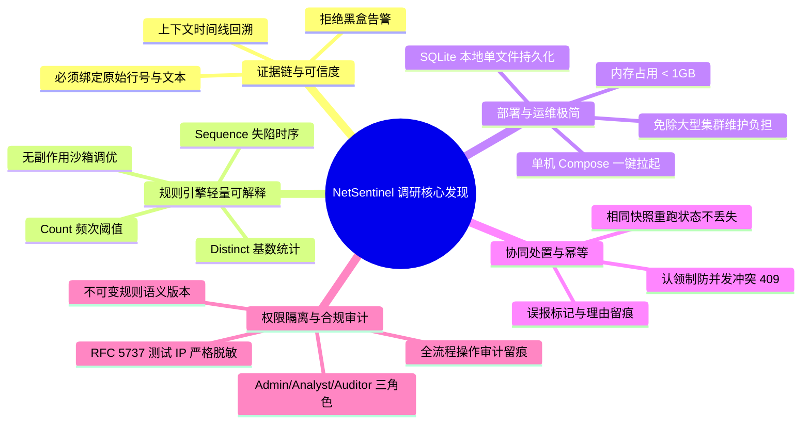
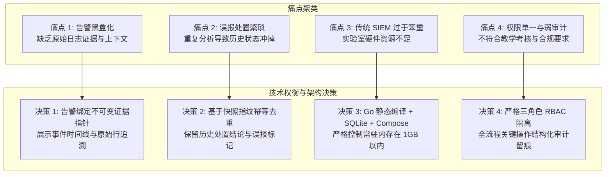

# NetSentinel 需求调研报告

## 1. 调研执行摘要

### 1.1 调研背景与目标

NetSentinel 定位于面向实验室、小型服务器和教学环境的轻量级日志检测与告警处置系统。为了避免“闭门造车”与凭空构想需求，团队在启动阶段严格执行《需求调研计划》，围绕“日志来源真实性、现有排查工作流痛点、告警可解释性诉求、合规与权限约束”四大核心主题展开深入调研。

本次调研旨在：

1. **摸清现状与真实痛点**：掌握目标用户（运维人员、安全分析员、合规审计员）日常使用 Shell 管道、Fail2ban 或重型 SIEM 时面临的效率瓶颈与操作风险；
2. **挖掘高频安全威胁场景**：复盘近半年真实服务器安全事件，提炼典型的离线检测规则（映射至内置规则 R-001 ~ R-008）；
3. **明晰系统差异化定位**：对比 ELK Stack、Wazuh、Fail2ban 及 GoAccess，确立 NetSentinel 在单机轻量化、不可变证据链和状态化协同处置方面的独特优势；
4. **输出高可信需求输入**：为阶段二后续的《需求规格说明书（SRS）》（WP-02b）提供具备 Given/When/Then 验收标准的用户故事与系统业务不变量。

### 1.2 核心调研结论

1. **“证据链缺失”是传统排查工具的最大痛点**：现有告警工具往往只有“发生攻击”的模糊结论，缺乏可追溯的原始日志行和上下文时序，导致分析员仍需肉眼翻阅日志二次查证，极耗时间；
2. **轻量免运维是实验室场景的刚性约束**：用户普遍反映企业级 SIEM（如 ELK、Wazuh）资源开销巨大（动辄 8GB~16GB 内存）、部署极重，严重挤占业务服务资源；迫切需要单机一键拉起、内存百兆级的极简工具；
3. **多事件因果关联（Sequence）是识别失陷的关键**：纯频次统计难以区分真正的失陷，而“多次暴力破解失败后突然成功登录”的时序模式是高危失陷的铁证；
4. **历史分析必须具备绝对幂等性**：重新运行历史分析任务时，已有告警的责任人、处置状态及人工填写的误报标记必须严格保留，不得重复告警或重置状态。

---

## 2. 调研对象与组织实施

依据调研分工矩阵，团队四名成员分别主责并实施交叉记录，全面覆盖了从系统运维、业务分析到教学审计的三类典型干系人：

| 干系人类型 | 代表人员 | 真实业务环境背景 | 访谈形式与时间 | 主责成员 | 协作记录人 | 归档纪要索引 |
|---|---|---|---|---|---|---|
| **系统运维/管理员** | 陈助教（SYS-ADMIN-01） | 负责实验室 7 台 Linux 物理机与虚机运维，维护 Nginx 反向代理与基础设施 | 线下会议室（信息楼 402 机房），2026-11-19 14:00–14:45 | **A**（组长/需求） | **C**（DevOps/存储） | [访谈纪要 01](file:///d:/DC/program-projects/Comprehensive/NetSentinel/Documentation/Planning/Interviews/01_系统运维管理员访谈纪要.md) |
| **日志排查使用者** | 严助教（SEC-ANALYST-01） | 安全实验室研二研究生，承担日常异常流量分析、攻击溯源与应急响应 | 腾讯会议（远程屏幕共享排查），2026-11-19 15:30–16:15 | **A**（组长/需求） | **D**（Web/测试） | [访谈纪要 02](file:///d:/DC/program-projects/Comprehensive/NetSentinel/Documentation/Planning/Interviews/02_日志排查使用者访谈纪要.md) |
| **教学检查与审计员** | 户老师（AUDIT-TEACHER-01） | 软件工程课程主讲教师，负责架构评估、DevOps 实践与工程规范考核 | 教研室工位面谈（信工楼 518），2026-11-20 10:00–10:45 | **D**（Web/测试） | **B**（架构/引擎） | [访谈纪要 03](file:///d:/DC/program-projects/Comprehensive/NetSentinel/Documentation/Planning/Interviews/03_教学检查与审计员访谈纪要.md) |

---

## 3. 四维组合调研方法及落地发现

### 3.1 半结构化深度访谈综述

三场访谈合计获得 135 分钟第一手问答录音与笔记，提炼出 14 项关键业务诉求，直接指导了产品形态与工程设计：

- **管理员侧**强调“不要让我维护复杂的数据库与中间件，提供单机 Docker Compose 和 SQLite，能容忍日志格式脏数据与时间戳时区补全”；
- **分析员侧**强调“告警必须带证据上下文时间线，支持多人认领防并发冲突，规则调优要在沙箱里跑，重跑分析绝不能丢误报状态”；
- **审计员侧**强调“严格三角色 RBAC 隔离，最后一个 admin 不能被禁用，全流程关键操作结构化审计，高危告警 Outbox 异步通知且绝不阻断主流程”。

### 3.2 历史排查工单与典型威胁场景挖掘

通过对实验室近半年历史排查工单、服务器应急响应记录和教学集群日志的深度复盘，团队归纳提炼出 8 类最具代表性的攻击模式，并与系统的内置检测规则（R-001 ~ R-008）建立了精确的一一映射关系：

| 规则代号 | 真实威胁场景与历史案例 | 攻击特征与度量维度 | 检测模式 | 窗口与基准阈值 | 风险等级 |
|---|---|---|---|---|---|
| **R-001** | **SSH 连续密码爆破**：公网僵尸网络针对 22 端口高频尝试常见字典密码 | 单一来源 IP 针对 SSH 登录失败事件的频次统计 | **Count** | 300 秒内失败 ≥ 10 次 | High |
| **R-002** | **Web 404 路径枚举探测**：攻击者使用 DirBuster/Nikto 快速遍历系统后台与备份文件 | 单一来源 IP 访问 HTTP 404 的**不同路径数（Distinct Path）**，规避爬虫单一页面重试 | **Distinct** | 300 秒内不同 404 路径 ≥ 20 个 | Medium |
| **R-003** | **SSH 暴力破解后失陷**：攻击者在经历多次爆破失败后，突然成功通过密码登录，标志着凭据已被攻破 | 单一来源 IP 在短时间内出现多次登录失败，**紧随至少一次登录成功** | **Sequence** | 600 秒内先 ≥ 5 次失败，后发生 ≥ 1 次成功 | **Critical** |
| **R-004** | **多用户密码探测（分布式撞库雏形）**：单一源 IP 尝试登录多个不同的用户名 | 单一来源 IP 在指定窗口内尝试的**不同用户名数（Distinct User）** | **Distinct** | 600 秒内不同用户 ≥ 5 个 | High |
| **R-005** | **敏感资产与高危路径探测**：探测 `.git/config`、`wp-login.php`、`phpmyadmin`、`etc/passwd` 等高敏感路径 | 单一来源 IP 匹配高危路径前缀或后缀的请求计数 | **Count** | 120 秒内命中敏感路径 ≥ 3 次 | High |
| **R-006** | **恶意扫描器特征指纹匹配**：User-Agent 携带 `sqlmap`、`Nikto`、`DirBuster` 等特征字符 | HTTP 请求行或 UA 命中特定正则且非白名单爬虫 | **Count** | 60 秒内匹配签名 ≥ 1 次 | Medium |
| **R-007** | **服务端 5xx 异常突发**：SQL 注入或非预期输入导致后端服务抛出未捕获异常或数据库崩溃 | 单一 IP 触发 HTTP 500~599 服务端错误的频次 | **Count** | 180 秒内 5xx 次数 ≥ 10 次 | High |
| **R-008** | **单一来源流量洪峰（应用层 DoS 试探）**：自动化压力测试或单 IP 疯狂刷接口消耗服务器资源 | 单一来源 IP 在极短时间内的总请求量计数 | **Count** | 60 秒内总请求数 ≥ 100 次 | Medium |

### 3.3 竞品分析与轻量化差异化定位

团队深入调研了当前安全与日志分析领域的 4 款主流工具（涵盖轻量级单机工具与企业级集中式平台），绘制了多维对比矩阵：

| 评估维度 | Fail2ban | GoAccess | ELK Stack (Elasticsearch) | Wazuh (OSSEC衍生) | **NetSentinel (本项目)** |
|---|---|---|---|---|---|
| **核心定位** | 基于正则的单机防火墙实时联动封禁 | 实时 Web 访问日志交互式终端分析器 | 企业级集中式日志检索与分析平台 | 开源主机安全监测与安全合规平台 | **面向实验室/教学环境的离线检测与协同处置系统** |
| **系统架构与部署复杂度** | 单机 Python 守护进程，依赖 systemd | 单机 C 编写，单二进制运行 | 极为庞大，依赖 Java JVM、Logstash、Kibana 多组件 | 复杂，采用 C/S 架构，需常驻 Agent、Manager 及 ES 集群 | **单机极简，Docker Compose + SQLite，免除任何外部集群依赖** |
| **运行时资源开销** | 内存 < 50MB，CPU 偶发峰值 | 内存 < 100MB，极低 | **极重**：堆内存通常 4GB~16GB 起步 | **较重**：Manager 需 2GB~4GB 内存 | **轻量可控**：常驻内存平稳在 200MB~500MB，单机无负担 |
| **告警证据追溯性** | 无，仅保留被封 IP 和时间 | 无告警功能，仅统计宏观图表 | 依赖 ES 原始索引，需人工编写复杂 DSL 查询 | 告警卡片包含部分上下文，但缺乏可视化完整时序线 | **极佳**：告警内建不可变证据链（包含行号、时间戳、原始文本时间线） |
| **分析检测模式** | 简单正则频次统计 | 纯宏观聚合统计，无规则引擎 | 支持复杂查询，但规则配置门槛极高 | 依赖 XML 规则与有限时序关联 | **支持 Count（频次）、Distinct（基数）、Sequence（因果时序）** |
| **业务处置与状态留痕** | 自动封禁，缺乏人工确认与误报闭环 | 无业务处置流 | 依赖 Alerting 插件，缺乏原生多人工单协同 | 提供简单告警标记，但缺乏防覆盖并发控制 | **具备认领（Claim）、误报理由留痕、乐观锁（409）防覆盖与幂等重跑** |
| **离线日志回放友好度** | 差（设计用于实时系统日志） | 好（支持读取指定文本日志） | 差（离线回放导入耗时费力） | 差（需通过模拟日志重放） | **极好**：面向离线数据集（Nginx/SSH），支持前 100 行预览与数据不可变 |

> **NetSentinel 差异化价值总结**：
> NetSentinel 避开了企业级 SIEM 的沉重部署与高额资源消耗，弥补了 Fail2ban 容易误杀且缺乏人工确认证据链的硬缺陷，填补了 GoAccess 缺乏安全规则告警与工单处置闭环的空白，为中小型环境提供了**“轻量部署、规则灵活、证据确凿、协同闭环”**的黄金平衡点。

### 3.4 样本日志核验与脱敏规范制定

依据对 `SAMPLE-NGINX-01/02` 及 `SAMPLE-SSH-01/02` 四份授权样本的实测核验（详见《授权样本验证与输入规格记录》），确认并冻结了以下输入规格：

1. **Nginx 规范**：支持标准的明文 `combined` 格式与固定模板的 JSON 格式。针对畸形请求行（`REQUEST_INVALID`）、转义双引号、超长行（64KB 限制）等边界情况设计了带状态机的扫描器；
2. **SSH 规范**：全面支持 Syslog RFC 3164 与 RFC 3339。针对 RFC 3164 缺少自然年份与时区偏移的根本缺陷，确定在 Web 导入界面**强制指定 `year` 与 `timezone`**，并制定了单文件归属单一自然年（禁止跨年反序）的约束；
3. **脱敏标准**：严格执行 RFC 5737 测试专用地址池（`192.0.2.0/24`、`198.51.100.0/24`、`203.0.113.0/24`）映射与虚拟占位符替换，杜绝任何真实凭据外流。

---

## 4. 用户核心痛点聚类与深度权衡（Trade-offs）

团队通过聚类分析，归纳出当前日志分析中最突出的 4 项核心矛盾，并在系统设计中做出了明确的技术权衡决策：

### 4.1 权衡一：实时内核级硬阻断 vs 离线分析辅助决策

- **冲突**：部分运维人员希望系统在发现攻击时立刻修改 iptables 封禁 IP。
- **调研权衡**：在高校机房与实验室环境中，由于大量学生通过同一教学楼的 NAT 网关访问，暴力封禁源 IP 极易造成整栋楼正常同学的“连带误杀”，引发重大教学事故。
- **架构决断**：**坚定聚焦于离线日志分析与高置信度告警处置**，系统给出确凿证据，处置关卡由人工审核确认；**明确不做实时内核抓包与自动硬封禁**（划入 Out-of-Scope）。

### 4.2 权衡二：动态自由脚本 DSL vs 预编译声明式规则模型

- **冲突**：部分高级安全人员希望像编写 Python/Lua 脚本一样自定义检测逻辑。
- **调研权衡**：非受限的动态脚本存在严重的死循环、内存泄露（OOM）及 ReDoS 拒绝服务风险，极易破坏规则引擎的稳定运行，且难以做到证据链的自动抽取与版本 Diff。
- **架构决断**：**采用强类型声明式的三种核心规则范式（Count、Distinct、Sequence）**。通过严谨的规则校验器与预编译模型保证执行确定性与计算性能，消除不安全脚本隐患。

### 4.3 权衡三：分布式大数据存储 vs 单机轻量 SQLite 本地存储

- **冲突**：传统日志系统多基于分布式 Elasticsearch 或 ClickHouse 架构。
- **调研权衡**：分布式组件依赖 ZooKeeper/JVM、多节点协调与复杂的维护技能，实验室单机部署往往因内存超限直接瘫痪。
- **架构决断**：**采用单机 Go 进程 + 本地持久化 SQLite 方案**。利用 SQLite WAL 模式支持高并发读取，利用事务保障状态发布的原子性，单机 Docker Compose 一键启动，内存平稳在几百兆。

---

## 5. 需求提炼与转化矩阵

基于上述调研发现与痛点分析，团队提炼并定义了 22 项功能需求（FR-01 ~ FR-22）与 2 项非功能需求（NFR-01 ~ NFR-02），并为其建立了用户故事与 Given/When/Then 验收标准雏形，为后续 WP-02b 的 SRS 提供直接输入：

### 5.1 痛点与功能需求映射矩阵

| 调研提炼的核心痛点 | 对应系统功能模块 | 需求编号与功能用例 | 目标增量 | 核心验收标准要点 |
|---|---|---|---|---|
| **排查工具部署重、环境准备困难** | 基础架构与容器化 | **FR-01 (UC-01)** 用户登录与会话 | v0.1 | 单机 Compose 一键启动，初始化默认 admin 账户并成功建立会话 |
| **日志格式多样、时间反序与脏数据** | 数据解析与导入管理 | **FR-03 (UC-03)** 日志预览、**FR-04 (UC-04)** 数据集导入、**FR-05 (UC-05)** 数据集管理、**FR-06 (UC-06)** 原始行追溯与错误 | v0.1 | 预览前 100 行，强制指定缺失的 year/timezone；单行错误安全转义并留痕，成功发布后数据集全量只读不可变 |
| **规则难以配置、调优缺乏验证环境** | 规则配置与沙箱治理 | **FR-07 (UC-07)** 规则草稿编辑、**FR-08 (UC-08)** 规则静态校验、**FR-09 (UC-09)** 无副作用沙箱、**FR-10 (UC-10)** 规则发布版本、**FR-11 (UC-11)** 规则启停、**FR-12 (UC-12)** 规则版本差异对比 | v0.1 / v0.2 | 规则支持 Count/Distinct/Sequence 强类型校验；沙箱回放不污染生产告警表；发布生成不可变语义版本与差异对比 |
| **告警黑盒化、缺乏可信证据上下文** | 分析任务与告警证据 | **FR-13 (UC-13)** 创建分析任务、**FR-14 (UC-14)** 任务进度状态、**FR-15 (UC-15)** 幂等重复分析、**FR-16 (UC-16)** 告警多维检索、**FR-17 (UC-17)** 证据链与时间线 | v0.1 / v0.2 | 告警卡片展示触发事件时间线，可精准反查原始行号；相同快照重跑基于指纹去重，保留既有处置状态 |
| **多人协同冲突、误报无法闭环** | 告警处置与工单协同 | **FR-18 (UC-18)** 告警认领转派、**FR-19 (UC-19)** 人工处置误报关闭 | v0.3 | 引入认领（Claim）流程，认领人及 admin 可处置；并发提交基于 `row_version` 返回 409 冲突，防止结论被盲目覆盖 |
| **操作痕迹不可查、外部通知不可靠** | 权限合规、审计与通知 | **FR-02 (UC-02)** 三角色用户管理、**FR-20 (UC-20)** 全流程审计追踪、**FR-21 (UC-21)** 飞书 Outbox 异步通知、**FR-22 (UC-22)** 系统工作台指标统计 | v0.3 | admin/analyst/auditor 最小权限隔离；审计记录敏感信息脱敏；飞书高危告警 Outbox 异步重试，主业务零阻塞 |

### 5.2 非功能需求定义

- **NFR-01：正确性、吞吐与资源约束**
  - **正确性**：规则引擎的检测结果必须与确定性金标准夹具（10,000 条端到端夹具及 100,000 条基准）100% 吻合，零漏报、零误触；
  - **性能吞吐**：在普通单机环境（4 核 CPU，8GB 内存）下，规则引擎纯内存计算吞吐不低于 50,000 事件/秒，端到端导入与检测全链路不低于 5,000 事件/秒；
  - **内存上限**：系统整体（Go 后端 + 规则引擎）峰值常驻内存（RSS）严格控制在 1GB 以内，杜绝 OOM 崩溃。
- **NFR-02：安全合规、可靠性与可复现性**
  - **权限与越权防御**：所有接口均在后端执行 RBAC 校验，Auditor 或未登录用户发起写操作坚决返回 403 Forbidden；
  - **事务一致性**：导入失败或分析任务中断时，暂存数据（staging）自动回滚，绝无半成品脏数据污染正式业务表；
  - **确定性可复现**：相同的数据集快照、规则版本与引擎语义版本，在任何时刻重新执行，生成的告警指纹与证据完全一致。

---

## 6. 系统边界与 Out-of-Scope 确认

根据项目章程与调研决断，为防止项目范围无序蔓延（Scope Creep），明确界定以下能力为 **Out-of-Scope（不做的边界）**：

| 排除项 | 理由与调研依据 | 替代合规方案 |
|---|---|---|
| **网络实时抓包与网卡监听** | 破坏离线分析定位；依赖底层硬件网卡与 root 权限，在容器及多租户环境下极易受阻 | 支持标准离线日志文件（Nginx/SSH）的高性能导入与回放 |
| **自动执行防火墙硬封禁（iptables）** | 高校与实验室 NAT 出口环境下误封率极高，缺乏人工审核极易引发教学服务中断 | 提供高确信度的证据链与飞书高危通知，由安全人员人工决策处置 |
| **常驻端侧主机 Agent 采集器** | 维护多平台客户端代价极高，易与实验室科研环境的自建监控冲突 | 面向服务端集中导出的标准明文日志文件 |
| **非受限自定义图灵完备脚本引擎** | 易引发未捕获的死循环、内存溢出（OOM）及 ReDoS 正则拒绝服务安全漏洞 | 提供预编译的 Count、Distinct、Sequence 强类型声明式规则范式 |

---

## 7. 结论与下阶段推进计划

本次需求调研通过对三类关键干系人的真人深度访谈、历史排查工单的威胁场景映射、主流竞品的差异化定位以及真实授权样本的格式实测，全面理清了 NetSentinel 的业务立足点与技术边界。调研成果充分证实了系统在**“离线轻量部署、不可变证据链溯源、状态化幂等处置与严格权限审计”**等方向的现实必要性。

**下阶段（WP-02b）推进计划**：

1. **发布需求规格说明书（SRS 基线）**：将本报告提炼的 22 个功能用例与 2 个非功能用例细化为包含 Given/When/Then 验收标准的规格条款；
2. **构建完整需求追溯矩阵（RTM）**：建立从调研痛点 → 用户故事 → SRS 条款 → 架构设计模块 → 测试用例的端到端双向追溯链；
3. **组织需求基线形式化评审**：邀请团队成员与指导教师进行需求基线审查，锁定 `srs-v1.0.0`，正式转入阶段三（系统分析与架构设计）。
