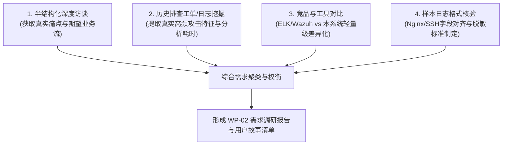

# NetSentinel 需求调研计划

## 1. 调研目标与背景

NetSentinel 定位于面向实验室、小型服务器和教学环境的轻量级日志检测与告警处置系统。为了避免"闭门造车"和凭空臆想需求，团队在启动阶段制定系统性的调研计划，旨在：

1. 深入了解目标用户（运维人员、安全排查人员、教师/审计者）在日常安全管理与日志排查中的**真实操作流程与核心痛点**；
2. 明确系统在导入日志、检测规则定制、告警可信度（证据还原）、权限隔离等方面的**刚性诉求与边界期望**；
3. 收集并规范真实日志样本（Nginx、SSH），梳理字段特征与脱敏规则，为 WP-02（SRS 与需求基线）提供坚实的现实依据。

## 2. 调研对象与分工矩阵

本次调研覆盖三类典型干系人角色，由团队成员分别主责并实施交叉记录：

| 干系人类型 | 访谈代表 | 背景与代表场景 | 主责成员 | 协作/记录人 |
|---|---|---|---|---|
| **系统运维/管理员** | 实验室服务器运维助教、学院机房网络管理员 | 维护多台 Linux 实验服务器，负责 Nginx 反代与基础安全配置，排查恶意爆破与扫描 | **A**（组长/需求） | **C**（DevOps/存储） |
| **日志排查使用者** | 软件工程课程助教、实验室安全研究员 | 面对海量日志缺乏直观分析工具，告警经常误报且无法回溯证据上下文 | **A**（组长/需求） | **D**（Web/测试） |
| **审计与教学检查者** | 课程指导教师、实验室合规检查老师 | 关注操作审计轨迹、多角色权限隔离、工程全流程合规性与过程留痕 | **D**（Web/测试） | **B**（架构/引擎） |

## 3. 调研方法与组合策略

结合课程教学要求的四种调研方法，团队采取**以深度访谈为主、结合工单挖掘、样本分析与竞品对比**的组合策略：



1. **半结构化深度访谈**：针对 3 类对象各设计 6–8 个开放性问题，重点了解"现在怎么做、最痛苦的是什么、如果有一套工具希望如何协助处置"，每次访谈时长约 25–40 分钟。
2. **历史排查场景与工单挖掘**：复盘近半年实验室 Linux 服务器遭受 SSH 密码字典爆破、WordPress 探针扫描、Web 路径枚举的历史排查记录，提炼典型检测规则场景（对应 R-001 至 R-008）。
3. **竞品对比分析**：对比开源轻量级工具（Fail2ban、GoAccess）与企业级 SIEM（ELK Stack、Wazuh、Splunk），明确 NetSentinel 聚焦"独立引擎 + 完整证据链 + 离线轻量处置"的差异化定位。
4. **日志样本实测与分析**：获取授权的真实 Nginx `access.log` 和 Linux `auth.log`，分析实际时间格式、分隔符变体、异常缺失字段等情况。

## 4. 访谈问题提纲

### 4.1 面向系统管理员（运维视点）

- Q1：您目前主要管理哪些类型的服务器与服务？日常会产生多大体量的日志？
- Q2：在日常运维中，您如何判断服务器是否正在遭受攻击？当前依赖什么工具或命令进行初步排查（如 `grep`、`awk`、`fail2ban`）？
- Q3：在收集和导入日志时，您最担心或遇到过的最大麻烦是什么（如格式混乱、时间戳时区不同、单次文件过大）？
- Q4：对于一套离线日志分析系统，您能接受的部署复杂度和机器资源开销是怎样的？是否希望支持容器化（Docker Compose）单机一键拉起？
- Q5：您对系统的数据保留与清理有什么具体要求？对于重复导入同一天的日志，您期望系统如何处理？

### 4.2 面向安全分析员（业务排查视点）

- Q1：当收到疑似攻击报警或进行事后排查时，您的标准排查流程是怎样的？
- Q2：现有排查工具给出的告警，存在哪些让您觉得不便的地方？（如：只有结论没有原始日志证据、误报太多、无法关联前后请求）
- Q3：对于一次告警，您需要看到哪些关键信息才敢做出处置决策？（例如：触发的具体规则、涉及的原始事件行数、触发时的精确上下文）
- Q4：多人共同参与排查时，如何避免同一条安全事件被多个人重复处理？
- Q5：发现某条规则持续产生误报时，您期望系统提供怎样的处置机制（标记误报、关闭、调参、沙箱测试）？

### 4.3 面向合规与审计人员（教学检查与合规视点）

- Q1：在实验室或教学环境中，对系统权限和角色划分有哪些严格要求？（如：分析员与审计员的只读权限、管理员的用户分配权）
- Q2：针对系统的关键操作（如用户登录、规则停用与发布、告警处置标记），审计人员需要追踪哪些维度的元数据？
- Q3：针对高危或紧急安全事件，除界面告警外，希望通过何种外部渠道进行即时提醒？（如企业微信、飞书、钉钉等自定义机器人）
- Q4：在软件工程教学场景下，您对系统如何保障开发全过程透明留痕有何建议？

## 5. 访谈纪要标准模板

每次访谈必须形成规范纪要并提交至仓库留痕，纪要结构如下：

```markdown
# 访谈纪要：[访谈对象代号/角色]

- **访谈时间**：YYYY-MM-DD HH:mm–HH:mm
- **访谈地点/形式**：[线下会议室 / 腾讯会议]
- **主访人**：[姓名/代号]
- **记录人**：[姓名/代号]
- **受访者基本信息**：[角色分类、所辖环境类型、工作年限/背景]

## 一、核心问答记录
[按提纲逐题记录要点，保留受访者真实原话与表述]

## 二、提炼的用户痛点与核心诉求
1. [痛点 1]
2. [痛点 2]

## 三、对产品设计与需求规格的输入
- 对规则引擎的输入：
- 对日志解析与导入的输入：
- 对界面与处置流程的输入：
- 对权限与合规的输入：

## 四、访谈者核签
- 受访者确认声明：[已阅纪要无误]
```

## 6. 样本授权与脱敏管理计划

为确保后续 WP-02、WP-06、WP-09 等工作包具备合规、真实的测试样本，制定以下管理规程：

1. **样本采集源**：
   - 实验室内部测试机 Nginx 访问日志 2 份（包含正常页面访问、爬虫及 404 扫描样本）；
   - 教学机房实验服务器 Linux SSH 登录日志 2 份（包含正常公钥/密码登录、暴力破解失败及成功登入样本）；
   - 合成测试集 1 份（由脚本按照确定性种子生成极端并发及超长 URL 样本）。
2. **脱敏处理流程**：
   - 使用统一脱敏脚本处理所有原始日志；
   - 涉及外网真实 IP 统一替换为 RFC 5737 测试专用地址池（`192.0.2.0/24`、`198.51.100.0/24`、`203.0.113.0/24`）；
   - 涉及内网 IP 统一映射为 `10.0.0.0/8` 私网保留地址；
   - 涉及真实用户名、密码串、Token 等敏感字眼统一哈希或占位符替换（如 `test_user_01`）；
   - 脱敏后的文件存放于受控目录并在 README 中登记其 SHA-256 校验和。

## 7. 时间进度与任务里程碑（对应第 9–10 周）

| 时间节点 | 计划完成任务 | 负责成员 | 交付物/产出状态 |
|---|---|---|---|
| **2026-11-18（第9周）** | 制定调研计划、完成问题提纲、确定访谈人选、完成教师立项审核 | A、D、全员 | WP-01 任务完成，项目章程与调研计划入库 |
| **2026-11-19 — 2026-11-21** | 分别执行 3 场深度访谈，完成历史工单与竞品分析，采集并脱敏日志样本 | A、B、C、D | 3 份访谈纪要入库、脱敏样本入库、竞品矩阵表 |
| **2026-11-22 — 2026-11-24** | 汇总访谈发现，提炼 24 个用例的验收标准，起草调研报告与用户故事清单 | A、D | 调研报告草稿、用户故事清单（Given/When/Then） |
| **2026-11-25（第10周）** | 课堂讲解需求调研发现与痛点，接受教师与同学点评，关闭 WP-02a | A（主讲）、全员 | 调研报告定稿 PR、需求基线输入确认 |
