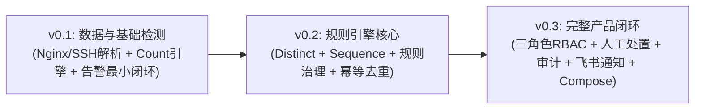

# NetSentinel 项目章程

## 1. 项目概况与业务目标

- **项目名称**：NetSentinel —— 可扩展安全规则引擎与日志关联分析平台
- **项目定位**：面向实验室、小型服务器和教学环境的安全日志分析系统。系统通过自主开发的 Go 独立规则引擎，对授权导入的 Nginx Web 访问日志及 Linux SSH 系统安全日志进行离线检测，识别可疑攻击与异常行为，生成包含完整原始证据链与命中原因的可解释告警，并提供基于 Web 平台的告警处置（认领、误报标记、关闭、备注）、审计日志追溯与飞书高危告警联动。
- **业务价值**：将海量原始孤立日志转化为可解释、可复现、可追溯的安全处置线索，解决小型场景下安全运维门槛高、现有企业级 SIEM 重型复杂、缺乏可信证据回溯与状态保留机制的痛点。
- **一句话描述**：面向实验室与小型服务器环境、基于自主研发 Go 规则引擎的轻量级日志关联分析与可解释告警处置平台。

## 2. 团队组织、角色职责与主讲安排

依据课程设计规范与实施指导，团队由 4 人组成，明确分工、交叉协作并实行代码与文档全流程 Review。

| 团队代号 | 姓名/GitHub | 核心负责领域 | 课程过程法定责任 | 课堂主讲规划 |
|---|---|---|---|---|
| **A** | 组长（需求与解析负责人） | 日志解析与统一事件定义、规则配置结构与语法校验 | 组长、需求调研第一责任人、SRS 需求规格说明书编制、计划与变更管理 | 第 2 次课（需求调研与痛点）/ 第 3 次课（SRS 规约） |
| **B** | 架构与引擎负责人 | Count、Distinct、Sequence 三类核心检测算法与独立引擎实现、引擎正确性测试 | 架构与设计第一责任人、分析模型（CRC/类图/状态图）、核心构件详细设计 | 第 4/5 次课（分析建模）/ 第 7 次课（详细设计与引擎） |
| **C** | DevOps 与存储负责人 | SQLite 持久化、告警幂等重跑与处置事务、RBAC/审计、飞书通知、Docker Compose | 仓库配置管理、分支保护、CI/CD 自动化工作流、容器化交付与发布保障 | 第 6 次课（概要设计与数据模型）/ 第 8 次课（DevOps 实践） |
| **D** | Web 与测试负责人 | React + TypeScript 前端工作台、交互流程、前后端联调 | 测试负责人、验收测试用例库维护、性能基准验证、《AI 使用报告》管理 | 第 2 次课（用户故事展示）/ 最终答辩演示 |

### 协作与交叉评审约定

- **代码与设计评审**：任意功能分支合并至 `main` 须创建 PR，经 CI 自动化检查通过，并由至少 1 名其他成员人工 Review 批准。
- **结对轮换机制**：
  - v0.1 阶段：A ↔ B（解析与引擎协议对接），C ↔ D（数据 API 与前端工作台联调）；
  - v0.2 阶段：A ↔ D（规则配置、沙箱与证据前端展示），B ↔ C（引擎执行、结果原子提交与幂等重跑）；
  - v0.3 阶段：全员交叉抽样评审与权限/通知端到端穿透测试。
- **工作量底线**：每位成员在整个学期内保证至少 10 个被合并的有效 PR，主讲至少 1 次课堂讲解，并在最终成果中能完整解释本人负责模块的所有实现与测试细节。

## 3. 过程模型与增量交付规划

采用**需求基线约束下的增量迭代开发过程**。项目划分为三个演进式、具备独立可运行验证能力的产品增量：

### 过程模型选型理由

1. **规避核心算法与数据解析早期风险**：安全规则引擎的检测正确性、窗口闭合边界（`[t-W, t]`）及日志多变格式存在显著技术不确定性。若采用传统瀑布模型，可能在项目晚期才发现引擎逻辑漏洞；若采用无序敏捷，则易丢失严格的文档可追溯性与架构一致性。
2. **最小纵向业务链路先行**：v0.1 优先打通"导入日志 → 标准化事件 → Count 检测 → 输出带证据告警"的端到端最小垂直切片，尽早验证前后端架构契约（WP-04）的可用性。
3. **严格质量内建与全流程留痕**：每一轮迭代均经历规划、构造、自动化测试、人工评审与回顾，缺陷与风险分析直接输入下一增量计划，满足课程教学中"不在仓库里发生的事视为没有发生"的要求。

## 4. 交付范围与边界约束

### 4.1 核心交付范围（v0.3 目标）

- **日志源支持**：UTF-8 编码的 Nginx `combined` 明文格式、确定模板的 Nginx JSON 格式、Linux SSH 系统安全日志（RFC 3164 / RFC 3339 文本）。
- **规则引擎**：Go 标准库实现的纯内存检测引擎。支持闭合时间窗口（微秒精度）、分组键（Group By）、Count 阈值周期触发、Distinct 独立属性去重统计、两阶段 Sequence（finish 优先消费 start）序列检测。
- **告警与证据**：逻辑指纹（稳定哈希去重）、聚合根告警（Finding）、触发原因描述、完整命中原始事件及上下文证据切片。
- **数据一致性与幂等**：重跑分析产生稳定指纹；已有告警的人工认领、误报标记、处置备注在重跑中予以保留；失败分析由 SQLite 事务完整回滚。
- **管理平台**：基于 React 19 + TypeScript + Vite 构建的中文管理控制台，覆盖工作台状态、数据集管理、规则库管理、分析任务及告警处置。
- **安全与审计**：基于 Session 的 `admin`、`analyst`、`auditor` 三角色 RBAC 后端越权拦截，关键业务操作同事务落库审计日志。
- **外部集成**：飞书自定义机器人 Webhook 高危告警通知，采用 Outbox 模式保障业务与通知的一致性。
- **交付形态**：单机 Docker Compose（Web + API + DB 卷）。

### 4.2 明确不做的范围边界（Out of Scope）

依据《NetSentinel 项目实施指导》与规划约束，以下特性**明确排除在当前核心交付范围之外**：

1. **非核心技术**：不自研未受限的通用 DSL 文本编译器、不实现流式乱序重排/水位线、不引入跨节点分布式任务调度或集群框架。
2. **非业务范畴**：系统定位为**离线日志分析平台**，不实现实时网络流量抓包（libpcap/eBPF）、不实现网络防火墙流量阻断、不开发主机常驻入侵检测 Agent、不执行自动化 IP 封禁或端口拉黑、不包含漏洞利用与攻击载荷生成功能。
3. **界面边界**：不提供终端 CLI/TUI 作为主要产品交互形态，统一使用 Web 工作台。

## 5. 干系人与访谈规划

项目涉及的核心干系人群体及其诉求如下：

| 干系人类型 | 代表角色 | 业务诉求与关注焦点 | 调研方法 |
|---|---|---|---|
| **系统管理员** | 实验室服务器运维人员 | 日志导入便捷性、格式容错率、存储资源占用、无外部重型依赖、一键 Docker 部署 | 半结构化深度访谈、实际生产日志样例脱敏采集 |
| **日志排查使用者** | 安全分析员 / 助教 / 开发者 | 告警必须有据可查（能看到原始日志上下文）、误报率可控、告警认领不冲突、重跑分析不乱刷数据 | 场景化工作流访谈、工单与历史故障排查复盘 |
| **合规与审计人员** | 课程教师 / 教学质量检查员 | 审计日志完整防篡改、三角色权限隔离、工程全流程规范可追溯、AI 辅助透明合规 | 课程要求对照评审、问卷调查、评审会议 |

## 6. 样本数据来源与授权合规管理

1. **数据源来源**：
   - 教学科研实验室 Linux 教学服务器实际产生并脱敏的 SSH 认证日志（`auth.log` / `secure`）；
   - 实验室内部测试 Web 服务（Nginx）产生的访问日志（`access.log`）；
   - 符合真实语义的结构化合成测试数据集（用于极端边界、高频攻击与自动化回归基准）。
2. **合规与脱敏规范**：
   - **零敏感数据原则**：所有进入 Git 仓库的日志样本必须经过脱敏处理。IP 地址映射为保留地址段（如 `192.0.2.0/24`、`198.51.100.0/24`），真实用户名替换为占位标识，剔除真实业务凭据、Cookie、Token 或用户隐私信息。
   - **授权留痕**：保留样本出处说明与授权声明，严禁在未获授权的情况下抓取或提交外部未公开系统的内部日志。

## 7. 初始风险清单与应对策略

| 风险编号 | 风险描述 | 影响严重度 | 发生概率 | 应对与缓解策略 |
|---|---|---|---|---|
| **RSK-01** | 日志格式碎片化（Nginx 自定义格式、SSH 多种 syslog 变体）导致解析失败率高 | 高 | 高 | 严格收敛输入规格至 3 种标准模板；解析器提供结构化预览与错误行定位；不支持格式给出明确错误码并跳过，不导致服务崩溃。 |
| **RSK-02** | 规则检测窗口与事件乱序语义模糊，导致时间边界计算错误 | 高 | 中 | 引擎统一以 UTC 微秒时间戳推进；日志导入阶段完成排序与绝对索引赋予；时间窗口严格定义为闭合区间 `[t-W, t]` 并由测试用例锁死行为。 |
| **RSK-03** | 规则引擎因状态对象无界膨胀发生内存泄漏（高基数 Key） | 高 | 中 | 引擎设置运行态内存与事件配额（Quota）；窗口滑动后立即清理过期桶；单次分析任务由独立上下文生命周期管控，支持超时强杀。 |
| **RSK-04** | 多人协作冲突与分支管理失控 | 中 | 中 | 开启 GitHub `main` 分支保护规则；严格执行 `Issue → Branch → PR → CI → Merge` 闭环；禁止直接 push `main`。 |
| **RSK-05** | 重复分析导致告警爆炸，冲掉已有工单状态 | 高 | 低 | 引入 Finding 逻辑指纹去重机制；重跑时通过数据库唯一约束与事务 upsert，完整保留历史负责人、状态及备注信息。 |

## 8. 教师选题审核与立项确认记录

- **审核时间**：2026-11-18（对应第 9 周课程启动检查点）
- **审核结论**：**通过立项**。选题聚焦轻量级安全日志分析与自主规则引擎开发，目标明确、边界清晰，符合软件工程课程设计"过程规范、协作留痕、质量内建"的综合教学要求。
- **指导教师意见**：
  1. 牢记工程规范，坚持 GitHub 全流程留痕，严禁跳过 PR 提交主分支；
  2. 严格把控 AI 使用边界，代码与设计决策必须由团队成员人工核验把关，答辩将针对每位成员负责模块进行逐一质询；
  3. 优先确保 v0.1 最小纵向链路按期落地，切忌贪大求全引入复杂分布式组件。
