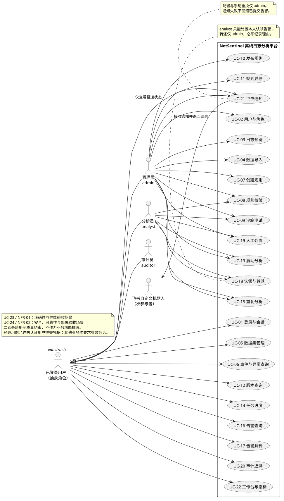

# NetSentinel 用例图

版本 v1.0.0-rc.2；对应 [SRS](SRS_v1.0.md) 第 2—3 节与[追溯矩阵 v0](追溯矩阵_v0.md)。图源为 [PlantUML](../../models/use-cases.puml)，渲染图与本次需求 PR 同步评审；本 PR 仅含这一张模型图。

抽象的已登录用户汇总三角色共有的读取权限。admin/analyst 单独连接其写操作；auditor 仅继承读取权限。登录是会话建立入口，未登录用户可以提交凭据。UC-21 的通知配置、重投和只读状态在关联上分别说明；授权日志源与飞书位于系统边界之外；日志源仅提供只读日志，调度是系统内部行为，不画成外部 Worker 参与者。UC-04 拉取、UC-13 分析与 UC-21 告警可自动执行；人工权限关联表示配置、重试或复核权，不表示每次必须人工触发。UC-23/24 是非功能验收场景，以图注表达。

该图只表达参与者与用例关系，不以 include 表示通用登录前置条件，不将内部 Engine、Worker 或数据库画成外部参与者。对象归属、CSRF、版本冲突和字段限制以 SRS 为准。

重新渲染：使用 PlantUML 的 `java -jar <plantuml.jar> -charset UTF-8 -tsvg models/use-cases.puml`，检查源文件语法后提交源与 SVG；工具仅在临时目录运行，不新增产品依赖。
